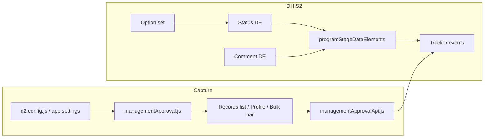

# Management approval — implementation guide

This document describes how to set up and operate **visit-level management approval** in the Capture Tracker Custom app: metadata on DHIS2, app configuration, roles, bulk approval, and how completed visits are treated as approved for reporting.

**DHIS2 version tested:** 2.40.x  
**App:** `capture/` (Capture Tracker Custom)

---

## Overview

Workflow follows the **Facility Checker** capture → approval lanes ([HISP Vietnam FCA project](https://projects.hispvietnam.org/projects/facility-checker-app-public)): data clerks complete visits (`PENDING`), approvers review on **Data approvals**, only `APPROVED` counts for reporting.

Management approval stores a workflow status on each **tracker event (visit)** using tracker data elements:

| Field | Purpose |
|--------|---------|
| **Management approval status** | `DRAFT` → `PENDING` → `APPROVED` / `REJECTED` |
| **Management approval comment** | Optional note or rejection reason |

The app can also support **enrollment-level** approval via tracked entity attributes (optional; not required for visit bulk approval).



---

## Critical DHIS2 rule

> **Tracker updates only accept data elements listed on `programStageDataElements`.**

Putting approval fields only in a **program stage section** is enough for the Capture **form UI**, but **not** for:

- Saving approval from the profile
- Bulk approval in Events view
- Any `POST /api/tracker` update with those data values

If approval DEs are missing from `programStageDataElements`, the tracker API returns:

```text
E1305: DataElement {uid} is not part of {programStageUid} program stage
```

That produces messages like: **“Updated 0 of 13 visits. 13 failed.”**

### Section vs programStageDataElements

| Link type | Form display | Tracker save / bulk approve |
|-----------|--------------|---------------------------|
| Program stage **section** only | Often yes | **No** |
| **programStageDataElements** | Yes | **Yes** |

Always verify both links exist for every stage that needs approval.

---

## Step 1 — Create metadata on DHIS2

### Option A — In-app setup (Configure → Authorities)

Superusers can create metadata from the app (no separate script):

1. Open **Configure → Authorities**
2. Under **Programs**, select every tracker program that should use approval
3. Click **Create approval metadata on DHIS2** (first-time server setup)
4. Review the status DE UID filled under **Approval metadata**, then click **Save**

This creates the option set, status/comment data elements, and links them to all stages of the selected programs. Re-running reuses existing metadata.

### Option B — Automated script (CI / servers without UI access)

From the `capture/` directory:

```bash
DHIS2_URL=http://localhost:8080 \
DHIS2_USER=your_user \
DHIS2_PASS='your_password' \
  node scripts/setup-management-approval-de.mjs
```

The script:

1. Creates option set **Management approval status** with codes: `DRAFT`, `PENDING`, `APPROVED`, `REJECTED`
2. Creates data elements:
   - **Management approval status** (TEXT + option set, domain TRACKER)
   - **Management approval comment** (LONG_TEXT, domain TRACKER)
3. For each configured program stage, tries to add both DEs to **`programStageDataElements`**
4. If `PUT /api/programStages/{id}` fails (often **E4030** when program rules reference the stage), falls back to creating a **Management approval** section and prints a warning

**Edit stage list** in the script if your instance uses different UIDs:

```javascript
// scripts/setup-management-approval-de.mjs
const STAGES = [
    { id: 'oj7dKrmA8eg', name: 'STI Diagnosis & Treatment' },
    { id: 'mX4OjpyZw3A', name: 'Prevention Form' },
    { id: 'hqJKFmOU6s7', name: 'Risk Behavior Screening Tool' },
]
```

At the end, the script prints the data element UIDs to use in app settings.

### Option C — DHIS2 Maintenance (manual)

1. **Option set** — name e.g. `Management approval status`, value type TEXT, options with **codes** exactly: `DRAFT`, `PENDING`, `APPROVED`, `REJECTED`
2. **Data elements** — domain type **Tracker**, assign the option set to the status DE
3. For **each program stage** that needs approval:
   - Open the program stage → **Data elements** tab
   - Add both DEs to the stage (this creates `programStageDataElements`)
   - Optionally add a section **Management approval** for layout

### Option D — SQL fallback (when API PUT fails with E4030)

On some instances, updating the whole stage via API is blocked because program rules reference existing stage data elements. You can insert rows directly (PostgreSQL example):

```sql
-- Replace IDs from your database:
--   programstageid  → SELECT programstageid FROM programstage WHERE uid = '{stageUid}';
--   dataelementid   → SELECT dataelementid FROM dataelement WHERE uid = '{statusDeUid}';

INSERT INTO programstagedataelement (
  programstagedataelementid, uid, created, lastupdated, programstageid, dataelementid,
  compulsory, allowprovidedelsewhere, sort_order, displayinreports, allowfuturedate,
  renderoptionsasradio, skipsynchronization, skipanalytics
)
SELECT nextval('hibernate_sequence'), 'CapApSti01', NOW(), NOW(),
  {programstageid}, {status_dataelementid},
  false, false, {next_sort_order}, true, false, false, false, false
WHERE NOT EXISTS (
  SELECT 1 FROM programstagedataelement psde
  JOIN programstage ps ON ps.programstageid = psde.programstageid
  JOIN dataelement de ON de.dataelementid = psde.dataelementid
  WHERE ps.uid = '{stageUid}' AND de.uid = '{statusDeUid}'
);
```

Repeat for the comment DE. **`uid` must be ≤ 11 characters** (DHIS2 constraint).

Then clear metadata cache:

```bash
curl -u user:pass -X POST 'http://localhost:8080/api/maintenance/cacheClear'
```

Verify via API (quote the URL in zsh):

```bash
curl -sS -u user:pass \
  'http://localhost:8080/api/programStages/{stageUid}?fields=programStageDataElements%5BdataElement%5Bid%5D%5D' \
  | grep -E 'statusDeUid|commentDeUid'
```

### Example UIDs (localhost dev instance)

| Item | UID |
|------|-----|
| Option set “Management approval status” | `XmV2ariGVeZ` |
| DE “Management approval status” | `ytR1lPO8w4L` |
| DE “Management approval comment” | `bHlMnRpGTF8` |
| STI stage | `oj7dKrmA8eg` |
| Prevention Form stage | `mX4OjpyZw3A` |
| Risk Behavior Screening stage | `hqJKFmOU6s7` |

Your production UIDs will differ; always use the UIDs printed by the setup script or Maintenance.

---

## Step 2 — Configure the Capture app

### Built-in defaults (`d2.config.js`)

```javascript
config: {
    approvalStatusDataElementId: {
        defaultValue: 'ytR1lPO8w4L',  // replace with your status DE UID
        type: 'string',
        label: 'Data element UID for visit management approval status',
    },
    approvalCommentDataElementId: {
        defaultValue: 'bHlMnRpGTF8',  // replace with your comment DE UID
        type: 'string',
        label: 'Data element UID for approval comment (optional)',
    },
    enrollmentApprovalAttributeId: {
        defaultValue: '',
        type: 'string',
        label: 'TEA UID for enrollment approval status (optional)',
    },
    enrollmentApprovalCommentAttributeId: {
        defaultValue: '',
        type: 'string',
        label: 'TEA UID for enrollment approval comment (optional)',
    },
}
```

After changing defaults, **rebuild and redeploy** the app:

```bash
cd capture
yarn build
# deploy to DHIS2 per your usual process (d2-app-scripts deploy, etc.)
```

### Per-instance overrides

In DHIS2: **Apps → App Management → Capture Tracker Custom → Configure**

Set the same UIDs if they differ from `d2.config.js` defaults.

### Auto-discovery (fallback)

If app settings are empty, `resolveManagementApprovalConfig()` searches loaded metadata for DE/TEA names matching patterns such as:

- `Management approval status`, `Approval status`
- `Management approval comment`, `Approval comment`

Explicit UIDs in app settings are preferred and always win when set.

---

## Step 3 — Roles and permissions

### Who can approve / reject (FCA approval lane)

| Assignment | Effect |
|------------|--------|
| DHIS2 role name in **`dataApprovalRoleNames`** (e.g. `FCA - Approval`) | Data approvals nav + approve/reject |
| DHIS2 **Superuser** | Same |
| `F_CAPTURE_DATA_APPROVAL` or `F_APPROVE_DATA` | Legacy fallback |

Capture lane roles (`dataEntryRoleNames`, e.g. `FCA - Tracker data capture`) do **not** get approval UI unless they also have an approval role.

Implemented in `canManageDataApproval()` / `userHasDataApprovalRole()` — `src/lib/captureAdmin.js`.

### Data entry (records-only) mode

Users with only data-entry roles (configured in `dataEntryRoleNames` in `d2.config.js`) get **records list only** — no admin sidebar — unless they are also superuser/program admin.

Check role assignment:

```bash
DHIS2_URL=http://localhost:8080 DHIS2_USER=... DHIS2_PASS='...' \
  node scripts/check-dhis2-capture-roles.mjs
```

---

## Step 4 — Status codes and business rules

### Stored values (option set codes)

| Code | Meaning |
|------|---------|
| `DRAFT` | Not submitted for approval (default) |
| `PENDING` | Submitted, awaiting manager |
| `APPROVED` | Manager approved |
| `REJECTED` | Manager rejected |

Aliases like `SUBMITTED` are normalized to `PENDING` in the app.

### FCA workflow (capture → approval)

| Step | Visit status | Approval DE (stored) | Who |
|------|--------------|----------------------|-----|
| Editing | ACTIVE | `DRAFT` or `REJECTED` | Capture lane |
| Complete visit | COMPLETED | **`PENDING`** | Capture lane |
| Manager approves | COMPLETED | `APPROVED` | Approval lane |
| Manager rejects | COMPLETED | `REJECTED` | Approval lane → capture fixes and completes again → `PENDING` |

**Data approvals** queue lists only **COMPLETED + `PENDING`** visits (`isEventPendingManagementApproval`).

### On save (profile / complete visit)

When a visit is marked **Complete**, approval DE is set to **`PENDING`** (unless already **`APPROVED`**). Reopening to **Active** resets to **`DRAFT`**.

Logic: `approvalStatusForEventSave()` / `mergeCompletionApprovalOnSave()`.

**Historical data:** Old completed events with empty/`DRAFT` approval may need **Submit for approval** or a backfill to `PENDING`/`APPROVED`.

---

## Step 5 — Using the UI

### Records list — Enrollments view

Columns (when configured):

- Enrollment status  
- Visit status (latest event)  
- Approval (effective status badge)

### Records list — Events view

For users with `canManageDataApproval`:

1. Switch view to **Events**
2. Select visits via checkboxes (eligible visits only — see `isEventBulkApprovalSelectable` in `src/features/tei-search/helpers.js`)
3. Use the bulk bar: **Approve** or **Reject** (opens modal for optional comment)
4. App calls `saveBulkEventManagementApproval()` — one tracker `UPDATE` per visit

If configuration is missing, a yellow notice explains that `approvalStatusDataElementId` must be set and DEs linked to the stage.

### Person profile

- **Event timeline:** approval badge; Approve / Reject / Submit actions when permitted
- **Management approval modal:** single or bulk count
- Completing a visit triggers auto-**APPROVED** on the approval DE

---

## Step 6 — How the app saves approval (technical)

### Tracker import

`src/services/managementApprovalApi.js`:

- `saveEventManagementApproval()` — merges status/comment into `dataValues`, calls `updateEvent()`
- `saveBulkEventManagementApproval()` — sequential updates; collects per-event success/failure

`src/services/trackerApi.js` — `updateEvent()` uses:

```http
POST /api/tracker?async=false&importStrategy=UPDATE
```

with payload shape:

```json
{
  "events": [{
    "event": "{eventUid}",
    "enrollment": "{enrollmentUid}",
    "orgUnit": "{orgUnitUid}",
    "program": "{programUid}",
    "programStage": "{stageUid}",
    "occurredAt": "2025-06-01",
    "status": "ACTIVE",
    "dataValues": [
      { "dataElement": "{statusDeUid}", "value": "APPROVED" }
    ]
  }]
}
```

### Smoke test (curl)

```bash
curl -sS -u user:pass -X POST \
  'http://localhost:8080/api/tracker?async=false&importStrategy=UPDATE' \
  -H 'Content-Type: application/json' \
  -d @- <<'EOF'
{
  "events": [{
    "event": "YOUR_EVENT_UID",
    "enrollment": "YOUR_ENROLLMENT_UID",
    "orgUnit": "YOUR_OU_UID",
    "program": "YOUR_PROGRAM_UID",
    "programStage": "YOUR_STAGE_UID",
    "occurredAt": "2025-06-01",
    "status": "ACTIVE",
    "dataValues": [{ "dataElement": "ytR1lPO8w4L", "value": "APPROVED" }]
  }]
}
EOF
```

Expect `"updated": 1` and empty `errorReports`.

---

## Code map (for developers)

| Area | Path |
|------|------|
| Status constants, config resolution, display rules | `src/lib/managementApproval.js` |
| Save / bulk save API | `src/services/managementApprovalApi.js` |
| Tracker mutations | `src/services/trackerApi.js` |
| Approval badge + modal | `src/components/approval/` |
| Records list columns + bulk UI | `src/features/tei-search/` |
| Profile approval actions | `src/features/profile/ProfileDetail.jsx` |
| Permissions | `src/lib/captureAdmin.js`, `src/hooks/useCaptureAdmin.js` |
| App settings schema | `d2.config.js` |
| Metadata setup script | `scripts/setup-management-approval-de.mjs` |
| Role check script | `scripts/check-dhis2-capture-roles.mjs` |

---

## Optional — Enrollment-level approval

1. Create **tracked entity attributes** (TEXT + same option set) for enrollment status and comment  
2. Add them to the **tracked entity type**  
3. Set `enrollmentApprovalAttributeId` and `enrollmentApprovalCommentAttributeId` in app settings  
4. Use profile enrollment tab actions (same modal, `saveEnrollmentManagementApproval()`)

Visit bulk approval does **not** require enrollment attributes.

---

## Optional — Backfill completed visits

To persist `APPROVED` on the server for old **COMPLETED** events (so indicators querying the DE match the UI):

1. Export events with `status=COMPLETED` and empty/missing approval DE  
2. Batch `tracker` `UPDATE` with `"value": "APPROVED"` for the status DE  
3. Or use a one-off script following `saveEventManagementApproval()` patterns

The app already **displays** completed visits as approved without backfill; backfill is only needed for **DHIS2 analytics / program indicators** that read the raw data element.

---

## Troubleshooting

| Symptom | Likely cause | Fix |
|---------|----------------|-----|
| **Updated 0 of N visits. N failed.** | E1305 — DE not on `programStageDataElements` | Link DEs on stage (Maintenance, script, or SQL); `cacheClear` |
| Yellow banner: bulk approval needs DE | `approvalStatusDataElementId` empty in running app | Redeploy app / set app settings |
| Approval column always **Draft** | DE not on event / not loaded in search | Link DE; ensure search returns `dataValues` for approval DE |
| PUT program stage fails E4030 | Program rules block full stage replace | Use Maintenance UI to add DEs, or SQL insert |
| Metadata CREATE returns 0 objects | Known limitation on some 2.40 setups | Use POST program stage PUT, Maintenance, or SQL |
| Superuser still sees data-entry-only UI | Role resolution order | Ensure `isDhis2Superuser` is checked before data-entry hide (`captureAdmin.js`) |
| Completed visit shows Approved but indicator is 0 | Indicator filters raw DE, not event status | Backfill `APPROVED` on completed events |

Bulk failures now append **First error: …** with the tracker message — use that string first.

---

## Deployment checklist

- [ ] Option set + two tracker DEs created  
- [ ] Both DEs on **`programStageDataElements`** for every relevant stage  
- [ ] Optional: **Management approval** section for form layout  
- [ ] `approvalStatusDataElementId` / `approvalCommentDataElementId` in app settings (or `d2.config.js` defaults)  
- [ ] App rebuilt and deployed  
- [ ] `POST /api/maintenance/cacheClear` after SQL/metadata changes  
- [ ] Tracker smoke test succeeds for one event per stage  
- [ ] Manager role has `F_CAPTURE_DATA_APPROVAL` or superuser  
- [ ] Bulk approve tested in Events view  
- [ ] (Optional) Backfill completed events for indicators  

---

## Related docs

- [Prevention program DE audit](./prevention-program-de-audit.md) — program rules vs stage data elements  
- Setup script: `scripts/setup-management-approval-de.mjs`
